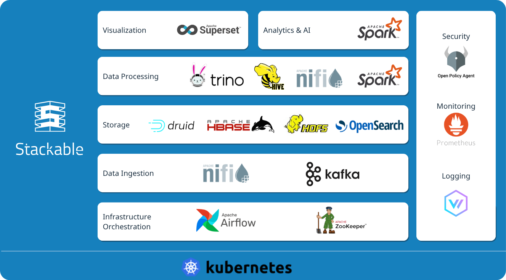

<p align="center">
  
</p>

<h1 align="center">Stackable Cockpit</h1>

[](https://GitHub.com/stackabletech/cockpit/graphs/commit-activity)
[](https://docs.stackable.tech/home/stable/contributor/index.html)
[](./LICENSE)

[Stackable Data Platform](https://stackable.tech/) | [Platform Docs](https://docs.stackable.tech/) | [Discussions](https://github.com/orgs/stackabletech/discussions) | [Discord](https://discord.gg/7kZ3BNnCAF)

Stackable Cockpit is the unified web UI for the Stackable Data Platform (SDP).
It provides a single place to work with the data services running on your platform.

It is part of the Stackable Data Platform, a curated selection of the best open source data apps like Apache Kafka®, OpenSearch, Trino or Apache Spark™, [all](#other-operators) working together seamlessly. Based on Kubernetes, it runs everywhere – on prem or in the cloud.

> [!WARNING]
> Stackable Cockpit is experimental.

## Features

- Single sign-on via any OIDC provider
- Trino SQL query editor and schema browser, with queries submitted under the logged-in user's name
- S3 file browser with preview, upload/download and search (opt-in, see [Feature Flags](#feature-flags))
- User-managed storage connections, stored in PostgreSQL
- Dashboard with bookmarks to frequently used tools

More modules will be added over time.

## Installation

> [!IMPORTANT]
> Serve Cockpit over HTTPS, because session cookies and credentials such as S3 keys pass through the browser connection.
> Cockpit itself serves plain HTTP, so terminate TLS at an Ingress or reverse proxy (see [Ingress and reverse proxy](#ingress-and-reverse-proxy)).

### Helm

A Helm chart for Kubernetes is included under [`deploy/helm/cockpit`](./deploy/helm/cockpit):

```bash
helm install cockpit ./deploy/helm/cockpit -f your-values.yaml
```

The chart needs an existing PostgreSQL database (`database.*` values). See the [chart README](./deploy/helm/cockpit/README.md) for the full list of values, and [docs/DATABASE.md](./docs/DATABASE.md) for the database settings, including TLS.

#### Ingress and reverse proxy

The chart creates a ClusterIP Service on port 3000.
Expose it with the chart's `ingress` values, or put your own Ingress, Gateway or load balancer in front of the Service.
Set `origin` and `auth.baseUrl` to the `https://` URL users open in the browser.
Behind a reverse proxy, also set the forwarded headers Cockpit trusts:

```yaml
origin: https://cockpit.example.com
auth:
  baseUrl: https://cockpit.example.com
proxy:
  protocolHeader: x-forwarded-proto
  hostHeader: x-forwarded-host
```

Only set the `proxy` headers if the proxy overwrites them, otherwise clients can spoof them.

### Docker

```bash
docker build . -f docker/Dockerfile \
  --build-arg TARGETARCH=x86 --build-arg VERSION=0.0.0-dev \
  -t cockpit:0.0.0-dev

docker run -p 3000:3000 cockpit:0.0.0-dev
```

## Configuration

The application is configured via environment variables.
Create a `.env` file at the project root, or set them in your deployment environment.
Invalid values (e.g. `abc` for an integer) stop the server at startup with an error that names the invalid variables.

### Feature Flags

| Variable                                            | Type                             | Default | Description                                                                                                                                                                             | Example                                                  |
| --------------------------------------------------- | -------------------------------- | ------- | --------------------------------------------------------------------------------------------------------------------------------------------------------------------------------------- | -------------------------------------------------------- |
| `STACKABLE_COCKPIT_COMPLETION_ENABLED`              | `boolean` (`"false"` to disable) | `true`  | Enables the SQL editor code-completion provider and the metadata endpoint. Set to `"false"` to fall back to plain syntax highlighting.                                                  | `STACKABLE_COCKPIT_COMPLETION_ENABLED=false`             |
| `STACKABLE_COCKPIT_STORAGE_BROWSER_ENABLED`         | `boolean` (`"true"` to enable)   | `false` | Shows the S3 file browser in the sidebar and activates routes under `/storage`. Must be explicitly opted in to expose storage credentials and the file-browser UI.                      | `STACKABLE_COCKPIT_STORAGE_BROWSER_ENABLED=true`         |
| `PUBLIC_STACKABLE_COCKPIT_STORAGE_TRANSFER_ENABLED` | `boolean` (`"true"` to enable)   | `false` | Shows Cut, Copy, Paste and Rename in the file browser and enables drag-and-drop move. When disabled, the server rejects copies, moves and renames via `/api/storage/transfer` with 404. | `PUBLIC_STACKABLE_COCKPIT_STORAGE_TRANSFER_ENABLED=true` |

### Storage Preview Limits

| Variable                                | Type              | Default             | Description                                                                                                                                                                                             | Example                                          |
| --------------------------------------- | ----------------- | ------------------- | ------------------------------------------------------------------------------------------------------------------------------------------------------------------------------------------------------- | ------------------------------------------------ |
| `STACKABLE_COCKPIT_TEXT_PREVIEW_BYTES`  | `integer` (bytes) | `262144` (256 KiB)  | Maximum bytes fetched when previewing text, TSV, or JSON files. Editable text files (text types except CSV/TSV, up to `PUBLIC_STACKABLE_COCKPIT_MAX_EDITABLE_FILE_SIZE`) are always fetched completely. | `STACKABLE_COCKPIT_TEXT_PREVIEW_BYTES=524288`    |
| `STACKABLE_COCKPIT_IMAGE_PREVIEW_BYTES` | `integer` (bytes) | `5242880` (5 MiB)   | Maximum bytes fetched when previewing image files.                                                                                                                                                      | `STACKABLE_COCKPIT_IMAGE_PREVIEW_BYTES=10485760` |
| `STACKABLE_COCKPIT_PDF_PREVIEW_BYTES`   | `integer` (bytes) | `26214400` (25 MiB) | Maximum bytes fetched when previewing PDF files.                                                                                                                                                        | `STACKABLE_COCKPIT_PDF_PREVIEW_BYTES=52428800`   |
| `STACKABLE_COCKPIT_FILE_PREVIEW_ROWS`   | `integer` (rows)  | `250`               | Maximum number of rows included in a tabular file preview (e.g. Parquet converted to CSV).                                                                                                              | `STACKABLE_COCKPIT_FILE_PREVIEW_ROWS=500`        |

### Storage Transfers

| Variable                                         | Type      | Default | Description                                                                                                                                                     | Example                                            |
| ------------------------------------------------ | --------- | ------- | --------------------------------------------------------------------------------------------------------------------------------------------------------------- | -------------------------------------------------- |
| `STACKABLE_COCKPIT_STORAGE_TRANSFER_CONCURRENCY` | `integer` | `8`     | Objects copied at once within one copy, move or rename request. Copies run server-side in the storage backend (S3 CopyObject); no data streams through the app. | `STACKABLE_COCKPIT_STORAGE_TRANSFER_CONCURRENCY=4` |

### Request Body Size

| Variable          | Type             | Default                                       | Description                                                                                                                                                                                                                                                                            | Example               |
| ----------------- | ---------------- | --------------------------------------------- | -------------------------------------------------------------------------------------------------------------------------------------------------------------------------------------------------------------------------------------------------------------------------------------- | --------------------- |
| `BODY_SIZE_LIMIT` | `string` (bytes) | `6M` in the container image (adapter: `512K`) | Maximum request body size accepted by the Node.js server ([adapter-node](https://svelte.dev/docs/kit/adapter-node#Environment-variables-BODY_SIZE_LIMIT)). Must be at least `PUBLIC_STACKABLE_COCKPIT_MAX_EDITABLE_FILE_SIZE`, otherwise saving larger files in the text editor fails. | `BODY_SIZE_LIMIT=12M` |

## Development

The required Node.js version is pinned in [`.node-version`](./.node-version).
Copy [`.env.example`](./.env.example) to `.env` and adjust the values for your OIDC provider, PostgreSQL database and Trino endpoint.
For a fully pre-configured local environment (Keycloak, Trino, Garage S3 and PostgreSQL on a local kind cluster), see [`dev/setup.sh`](./dev/setup.sh).

```bash
npm install          # Install dependencies
npm run dev          # Start the dev server (http://localhost:5173)
npm run build        # Build for production
npm run preview      # Preview the production build

npm run format       # Format all code
npm run check        # Type checking
npm run lint         # Linting
npm run knip         # Report unused files, exports and dependencies
npm run test:unit    # Run the Vitest unit tests
npm run test:arch    # Run the architecture tests
npm run test:e2e     # Run the Playwright end-to-end tests (requires Docker)

npm run generate:antlr   # Regenerate the lexer/parser after editing the SQL grammar
```

## Documentation

Database setup and migrations are described in [`docs/DATABASE.md`](./docs/DATABASE.md).

The documentation for all Stackable products can be found at [docs.stackable.tech](https://docs.stackable.tech).

If you have a question about the Stackable Data Platform, contact us via our [homepage](https://stackable.tech/) or ask a public question in our [Discussions forum](https://github.com/orgs/stackabletech/discussions).

## Accessibility

Stackable Cockpit targets [WCAG 2.2](https://www.w3.org/TR/WCAG22/) level AA.
This is a superset of [BITV 2.0](https://www.gesetze-im-internet.de/bitv_2_0/), which is based on [WCAG 2.1](https://www.w3.org/TR/WCAG21/) level AA.
As the project is still experimental, it may not fully meet these requirements yet.
We treat every accessibility violation as a bug, so please [open an issue](https://github.com/stackabletech/cockpit/issues) if you find one.

## About The Stackable Data Platform

Stackable Cockpit is written and maintained by [Stackable](https://stackable.tech) and it is part of a larger data platform.



Stackable makes it easy to operate data applications in any Kubernetes cluster.

The data platform offers many operators, new ones being added continuously. All our operators are designed and built to be easily interconnected and to be consistent to work with.

The [Stackable GmbH](https://stackable.tech/) is the company behind the Stackable Data Platform. Offering professional services, paid support plans and custom development.

We love open-source!

## Other Operators

These are the operators that are currently part of the Stackable Data Platform:

- [Stackable Operator for Apache Airflow](https://github.com/stackabletech/airflow-operator)
- [Stackable Operator for Apache Druid](https://github.com/stackabletech/druid-operator)
- [Stackable Operator for Apache HBase](https://github.com/stackabletech/hbase-operator)
- [Stackable Operator for Apache Hadoop HDFS](https://github.com/stackabletech/hdfs-operator)
- [Stackable Operator for Apache Hive](https://github.com/stackabletech/hive-operator)
- [Stackable Operator for Apache Kafka](https://github.com/stackabletech/kafka-operator)
- [Stackable Operator for Apache NiFi](https://github.com/stackabletech/nifi-operator)
- [Stackable Operator for OpenSearch](https://github.com/stackabletech/opensearch-operator)
- [Stackable Operator for Apache Spark](https://github.com/stackabletech/spark-k8s-operator)
- [Stackable Operator for Apache Superset](https://github.com/stackabletech/superset-operator)
- [Stackable Operator for Trino](https://github.com/stackabletech/trino-operator)
- [Stackable Operator for Apache ZooKeeper](https://github.com/stackabletech/zookeeper-operator)

And our internal operators:

- [Commons Operator](https://github.com/stackabletech/commons-operator)
- [Listener Operator](https://github.com/stackabletech/listener-operator)
- [OpenPolicyAgent Operator](https://github.com/stackabletech/opa-operator)
- [Secret Operator](https://github.com/stackabletech/secret-operator)

## Contributing

Contributions are welcome.
Follow our [Contributors Guide](https://docs.stackable.tech/home/stable/contributor/index.html) to learn how you can contribute.
Before submitting changes, run the formatting, type checks, linting and end-to-end tests listed under [Development](#development).
All contributors will have to sign a [Contributor License Agreement](https://github.com/stackabletech/.github/blob/main/cla.md).
This is enforced automatically when you submit a Pull Request where a bot will guide you through the process.

## License

[Open Software License version 3.0](./LICENSE).

This project bundles the Trino SQL grammar and code derived from it, which are licensed under the [Apache License, Version 2.0](./LICENSE-Apache-2.0).
The relevant source files carry upstream attribution headers.

## Support

Get started with the community edition! If you want professional support, [we offer subscription plans and custom licensing](https://stackable.tech/en/plans/).

## Sponsor

If you want to support our work but don't need professional support please consider [sponsoring](https://github.com/sponsors/stackabletech) our work.
